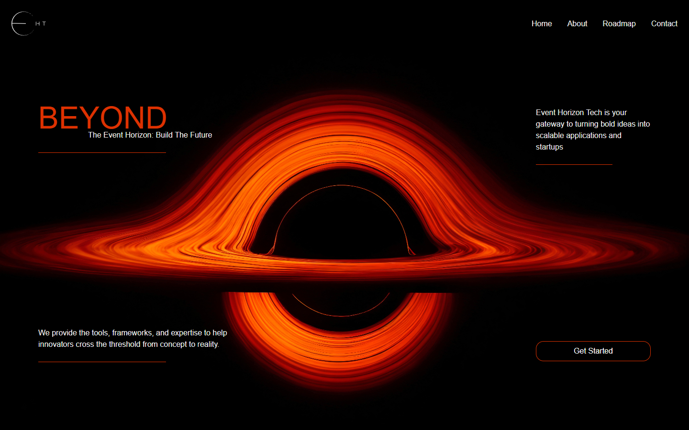

# Event Horizon Tech — early team-site snapshot

An early Next.js agency-site prototype with a black-hole hero, service/roadmap
content and a custom image carousel.



## History and contribution

Application baseline `a752d6f` is the initial commit shared with the later
[event-horizon fork](https://github.com/boyInShadows/event-horizon) and
[EventHorzionTeam repository](https://github.com/EventHorzionTeam/event-horizon).
Git history attributes this initial implementation to Ramtin; later team history
and branding remain credited. These repositories represent related versions of
the same website, rather than separate completed products.

This presentation pass reuses the reviewed unused-dependency and dark-theme
corrections from the later fork. It does not import the later site's carousel
design or additional sections. The header labels and Get Started control remain
placeholders, and a current commercial deployment has not been verified.

## Run this version

Verified with Node.js 24.11.1 and npm 11.6.2 on Windows. The lockfile pins Next.js
15.3.5 and React 19.1.0; Tailwind CSS 4 and GSAP are also included. No application
credentials are needed. Google font downloads need build-time network access.

```sh
git clone https://github.com/boyInShadows/EventHorizonTech.git
cd EventHorizonTech
npm ci
npm run dev
```

Open <http://localhost:3000>. Existing checks and production preview:

```sh
npm run lint
npm run build
npm start
```

The [carousel](app/components/mainPage/section3/imageSlider/index.js) manages
its own previous/next state; the unused React 16–18-only react-slider dependency
was removed so normal installation works with React 19. Retained versions were
not upgraded.

## Verification and limits

On 2026-10-30, locked installation, lint and production build passed. Edge verified
previous/next carousel positions and light text under both system theme preferences.
Desktop and emulated mobile views loaded without page errors. Mobile still
overflows: a 390px viewport produced a 435px document. Build retains its Turbopack
config deprecation warning; there is no test script or quality CI.

A dated npm audit reported 14 advisories (2 critical, 9 high, 2 moderate, 1 low).
Full accessibility, physical devices and production security/deployment remain
unverified. Framework, team and asset rights remain unchanged.
